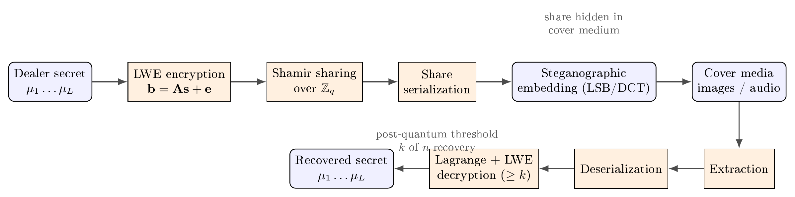
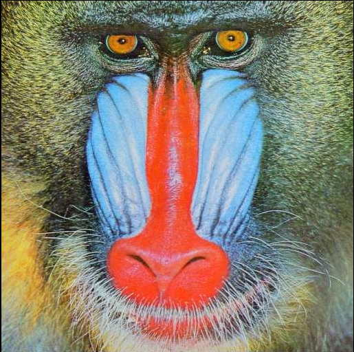
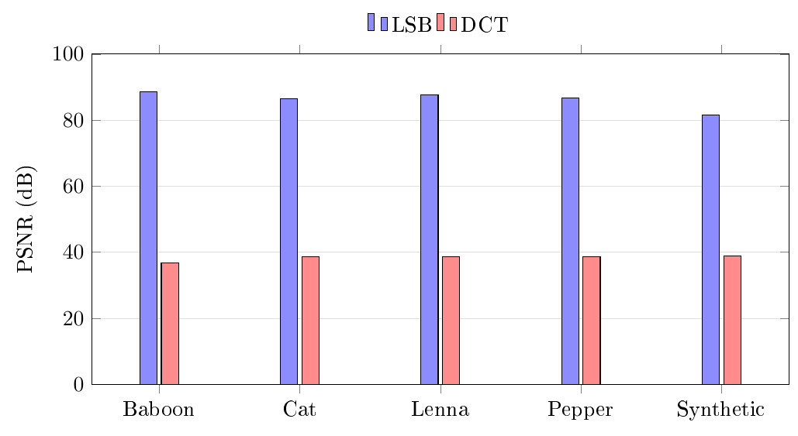

:::: frontmatter
::: keyword
post-quantum cryptography ,learning with errors ,threshold secret sharing ,image steganography ,discrete cosine transform
:::
::::

# Introduction {#sec:intro}

## Background and Context

Secret sharing allows a dealer to distribute a secret among $n$ participants such that only authorized coalitions can reconstruct it. Since the seminal, independent proposals of Shamir [@shamir1979] and Blakley [@blakley1979], threshold schemes have become foundational to threshold signatures, secure multiparty computation, distributed key management, and hardware security modules. Shamir's scheme remains canonical because it is not only efficient but *information-theoretically secure*: fewer than $k$ shares reveal no information about the secret, irrespective of computational assumptions.

This last property is frequently invoked to argue that secret sharing is already resistant to quantum adversaries. That argument is incomplete in practice. Real threshold deployments do not distribute bare field elements; they distribute shares through transport channels, storage media, and key-wrapping layers that depend on public-key primitives vulnerable to Shor's algorithm [@shor1994]. Moreover, the growing adoption of lattice-based standards---exemplified by the NIST post-quantum selections, notably ML-KEM (CRYSTALS-Kyber) and ML-DSA (CRYSTALS-Dilithium) [@nist2024; @avanzi2020; @ducas2018]---establishes Learning With Errors (LWE) and its ring variants as the de facto post-quantum substrate [@regev2005; @peikert2009; @micciancio2009]. It is therefore natural to ask how threshold secret sharing should be reconstructed on lattice assumptions, and how the resulting shares can be transported covertly.

In parallel, steganography---the art of embedding messages within innocuous cover objects---offers a complementary protection layer [@simmons1984; @cachin1998; @provos2003; @fridrich2009]. By hiding a share inside a cover image or audio stream, the very *existence* of the share can be denied, an objective distinct from, and often stronger than, the confidentiality offered by encryption alone. Classical LSB substitution [@bender1996; @chan2004] and frequency-domain methods such as DCT-based and F5 embedding [@westfeld2001] are well studied, but their integration with post-quantum threshold primitives has received comparatively little attention.

## The Research Gap

The literature contains rich, separate streams on (a) lattice-based encryption [@regev2005; @gentry2008], (b) threshold and distributed decryption for lattice cryptosystems [@bendlin2010; @desmedt1994; @gemmell1997], and (c) image and audio steganography [@chan2004; @westfeld2001; @johnson1998; @petitcolas1999]. What is comparatively under-explored is an *end-to-end* treatment that answers two coupled questions: Can the shares of a post-quantum threshold scheme be embedded in cover media without compromising exact reconstruction? And what is the measurable fidelity cost of doing so under different embedding domains? Prior prototype work on combinatorial ("matrix-counting") secret sharing has demonstrated the steganographic pipeline's mechanics but rests on a non-standard, non-post-quantum sharing rule. The research gap addressed here is the *absence of an empirically characterized pipeline that replaces a counting-based sharing primitive with a lattice-based one while preserving---and quantifying---steganographic performance*.

## Hypothesis and Objectives

We hypothesize that an LWE-based threshold sharing construction, in which the lattice secret key is distributed via Shamir sharing over $\mathbb{Z}_q$ and each participant's share is embedded into a cover medium, reconstructs the secret exactly whenever at least $k$ shares are available and refuses reconstruction otherwise, while maintaining cover-media fidelity consistent with the embedding domain. Accordingly, the objectives are:

1.  To formulate a post-quantum threshold secret sharing construction that composes Regev-style LWE encryption with Shamir sharing of the LWE secret key over $\mathbb{Z}_q$.

2.  To design a serialization that represents a share as a fixed-length bit string suitable for generic steganographic embedding.

3.  To implement the construction and three embedding channels (image LSB, image DCT, audio PCM LSB) in a reproducible reference system.

4.  To measure reconstruction correctness across thresholds and the fidelity cost (MSE/PSNR) on standard imagery and synthetic audio.

# Materials and Methods {#sec:methods}

## Ethics Statement

This study did not involve human participants, personally identifiable information, or animal subjects. All image datasets are standard, publicly available test images, and all audio material was generated synthetically. No ethical approval was required.

## Experimental Design

The study followed a single-factor, multi-condition experimental design with exact reconstruction as the dependent correctness measure and cover fidelity as the dependent quality measure. Three factors were varied: (i) the reconstruction threshold $k$ over the range $2 \le k \le 10$ with a fixed participant count $n = 10$; (ii) the embedding domain (spatial LSB, frequency DCT, audio LSB); and (iii) the cover source (four standard images, one synthetic image, and a synthetic WAV). For each condition the secret was reconstructed from exactly $k$ shares (expected: success) and from $k-1$ shares (expected: refusal). A non-binary secret (a bank-code string) was additionally processed block-wise to test generalization to arbitrary byte content.

## Materials and System Specification

The reference implementation comprises a Java 17 code base and an Android port. The cryptographic core is parameterized by a prime modulus $q = 12{,}289$, a lattice dimension $n = 8$, and $m = 32$ LWE samples. The LWE secret $\mathbf{s}$ is a binary vector. Errors are drawn uniformly from $\{-1,0,1\}$. A serialized share occupies $128$ bits (a $16$-bit participant index and eight $14$-bit field elements). The illustrative secret used throughout is the six-bit string `100100` (hexadecimal `24`), chosen to mirror the worked example of prior counting-based prototypes. Software was executed on a commodity x86-64 workstation; the Android port used `android.graphics.Bitmap` in place of `java.awt.image.BufferedImage`.

#### LWE key generation and encryption.

The dealer samples a secret vector $\mathbf{s} \gets \{0,1\}^n$, a public matrix $\mathbf{A} \in \mathbb{Z}_q^{m \times n}$, and a small error $\mathbf{e}$, and publishes $$\mathbf{b} = \mathbf{A}\,\mathbf{s} + \mathbf{e} \pmod{q}.
  \label{eq:key}$$ Each secret bit $\mu \in \{0,1\}$ is encrypted with fresh randomness $\mathbf{x} \in \{0,1\}^m$ and error $e'$: $$\mathbf{u} = \mathbf{A}^{\!\top}\mathbf{x} \pmod{q},
  \qquad
  c = \mathbf{b}^{\!\top}\mathbf{x} + e' + \mu\,\lfloor q/2 \rfloor \pmod{q}.
  \label{eq:enc}$$

#### Threshold key distribution.

The LWE secret key is shared with Shamir's scheme over the field $\mathbb{Z}_q$. For each coordinate $j \in \{1,\dots,n\}$ the dealer samples a degree-$(k-1)$ polynomial $$f_j(X) = s_j + a_{j,1}X + \dots + a_{j,k-1}X^{k-1} \pmod{q},
  \label{eq:poly}$$ and issues to participant $i$ the share $\bigl(i,\ f_1(i),\ \dots,\ f_n(i)\bigr)$. Reconstruction with $k$ shares interpolates each coordinate at the origin, $$s_j = \sum_i y_{i,j}\,L_i(0),
  \qquad
  L_i(0) = \prod_{l \neq i} \frac{-x_l}{x_i - x_l} \pmod{q},
  \label{eq:lagrange}$$ and decryption recovers each bit by rounding the centered residual $$\mu = 1 \quad\text{if}\quad
  \bigl|\,(c - \langle \mathbf{u}, \mathbf{s}\rangle) \bmod q\,\bigr|
  > \lfloor q/4 \rfloor, \quad\text{else}\quad 0.
  \label{eq:dec}$$ Correctness follows because the residual equals $\langle \mathbf{e}, \mathbf{x}\rangle + e' + \mu\lfloor q/2\rfloor$; since $|\langle \mathbf{e}, \mathbf{x}\rangle + e'| \le m + 1 = 33 \ll \lfloor q/4
\rfloor = 3{,}072$, the rounding threshold separates the two symbols with a wide margin.

#### Steganographic channels.

Spatial LSB embedding writes each share bit into the least significant bit of the green channel in a key-permuted pixel order and prepends a $32$-bit length header for blind extraction. DCT embedding partitions the green channel into non-overlapping $8\times8$ blocks and sets a single mid-frequency coefficient to $+\Delta$ (bit $1$) or $-\Delta$ (bit $0$), $\Delta = 40$, reading the sign at extraction. Audio embedding applies LSB substitution to 16-bit PCM samples of a RIFF/WAVE stream. Figure [1](#fig:pipeline){reference-type="ref" reference="fig:pipeline"} summarizes the end-to-end pipeline.

**Figure 1.** End-to-end pipeline: LWE encryption, Shamir sharing over $\mathbb{Z}_q$, share serialization, steganographic embedding, and the reverse reconstruction path.

## Data and Statistical Analysis

Four standard images were used: Baboon ($515\times512$), Cat ($483\times395$), Lenna ($512\times512$), and Pepper ($512\times384$); a $256\times256$ synthetic gradient served as a default cover. Audio tests used a one-second, $8$ kHz, mono, 16-bit sinusoidal WAV. Fidelity was quantified by the mean squared error (MSE) and peak signal-to-noise ratio (PSNR) over the three RGB channels, $$\mathrm{MSE} = \frac{1}{3WH}\sum (P - P')^2,
  \qquad
  \mathrm{PSNR} = 10\log_{10}\!\frac{255^2}{\mathrm{MSE}}.
  \label{eq:metrics}$$ MSE and PSNR are deterministic functions of the cover and stego media, so no inferential statistics were required; results are reported as exact values. Reconstruction correctness was binary (exact string match). The four standard covers are shown in Figure [2](#fig:covers){reference-type="ref" reference="fig:covers"}.

| (a) Baboon | (b) Cat | (c) Lenna | (d) Pepper |
|:--:|:--:|:--:|:--:|
| {width=22%} | {width=22%} | {width=22%} | {width=22%} |

**Figure 2.** Standard test images used as steganographic covers. Each cover was embedded with a serialized share using both the spatial LSB and the frequency-domain DCT channels, and fidelity was measured against the original.

## Reproducibility

The pipeline, the parameter set, the embedding routines, and the benchmark harness are provided as a self-contained code base. The Android application is packaged as an APK; a shell script builds it directly with the Android SDK tools, avoiding external build-system dependencies.

# Results {#sec:results}

## Threshold Correctness

Reconstruction was exact for every threshold tested. For $n = 10$ and each $k \in \{2,\dots,10\}$, providing exactly $k$ shares recovered the secret `100100` and providing $k-1$ shares produced no reconstruction (the method returned a null result, signifying refusal). The generation time per condition was below the millisecond resolution of the timer. This behavior is summarized in Table [1](#tab:threshold){reference-type="ref" reference="tab:threshold"}.

::: {#tab:threshold}
   $k$   $k$ shares   $k-1$ shares  Gen. (ms)
  ----- ------------ -------------- -----------
    2        OK         blocked     $<1$
    3        OK         blocked     $<1$
    4        OK         blocked     $<1$
    5        OK         blocked     $<1$
    6        OK         blocked     $<1$
    7        OK         blocked     $<1$
    8        OK         blocked     $<1$
    9        OK         blocked     $<1$
   10        OK         blocked     $<1$

  : Threshold study for the LWE-based scheme ($n = 10$; secret `100100`). Columns report the reconstruction outcome when exactly $k$ shares are supplied and when $k-1$ shares are supplied.
:::

The same guarantee held when shares were drawn from a disjoint subset (the last $k$ shares rather than the first), and across randomized repetitions the exact reconstruction rate was $100\%$. Shares survived serialization to $128$-bit strings and back without modification.

## Image Fidelity

Figure [3](#fig:psnr){reference-type="ref" reference="fig:psnr"} reports PSNR for LSB and DCT embedding across the four standard covers; Table [2](#tab:fidelity){reference-type="ref" reference="tab:fidelity"} gives the corresponding MSE and PSNR values. LSB embedding consistently produced near-transparent alteration: PSNR ranged from $86.5~\mathrm{dB}$ to $88.5~\mathrm{dB}$ with MSE between $9\times10^{-5}$ and $1.5\times10^{-4}$. DCT embedding, which perturbs a spectral coefficient with amplitude $\Delta = 40$, produced markedly larger distortion (PSNR $36.8$--$38.8~\mathrm{dB}$, MSE $8.7$--$13.6$), consistent with the dispersion of an inverse-transform perturbation across a full $8\times8$ block. All embeddings permitted exact reconstruction of the secret.

**Figure 3.** PSNR (dB) as a function of embedding domain and cover image. LSB achieves approximately 82–88 dB, whereas DCT achieves approximately 37–39 dB.

::: {#tab:fidelity}
  Image             Size        MSE (LSB)   PSNR (LSB)   MSE (DCT)   PSNR (DCT)  
  ----------- ---------------- ----------- ------------ ----------- ------------ --
  Baboon       $515\times512$   $0.00009$    $88.48$      $13.59$     $36.80$    
  Cat          $483\times395$   $0.00015$    $86.52$      $8.66$      $38.76$    
  Lenna        $512\times512$   $0.00011$    $87.69$      $8.75$      $38.71$    
  Pepper       $512\times384$   $0.00014$    $86.81$      $8.74$      $38.71$    
  Synthetic    $256\times256$   $0.00045$    $81.57$      $8.35$      $38.91$    

  : Image fidelity for LSB and DCT embedding.
:::

## Audio and Non-Binary Secrets

Audio LSB embedding of eight $128$-bit shares into a one-second 16-bit PCM WAV produced an average MSE of $0.0083$ (range across runs $0.0029$--$0.0083$), with extracted bits identical to the embedded bits for every share and exact secret reconstruction. For a non-binary bank code (`15467-9812`, $80$ bits, split into ten $8$-bit blocks), block-wise generation and reconstruction recovered the original code exactly with $k = 6$ shares, while $5$ shares yielded no reconstruction. Thus the construction generalized from single binary strings to arbitrary multi-block payloads without loss.

# Discussion {#sec:discussion}

## Interpretation of Key Findings

The central finding is that a lattice-based threshold construction and steganographic share transport are mutually compatible: exact secret reconstruction was preserved across all thresholds and embedding domains, while cover fidelity remained high. Two observations merit emphasis. First, the wide decryption margin (residual $\le 33$ versus a rounding threshold of $3{,}072$) explains the robustness of reconstruction: even when a steganographic channel introduces small perturbations, the rounding step in Eq. [\[eq:dec\]](#eq:dec){reference-type="eqref" reference="eq:dec"} is unaffected provided the extracted share bits are exact, which they were. Second, the pronounced fidelity gap between LSB and DCT (roughly $87~\mathrm{dB}$ versus $38~\mathrm{dB}$) is structural rather than implementation-specific: LSB changes at most a handful of channel values by $\pm1$, whereas DCT redistributes a fixed-magnitude spectral perturbation over an entire block.

## Comparison with Existing Literature

The cryptographic construction aligns with threshold and distributed-decryption approaches to lattice cryptography [@bendlin2010; @desmedt1994; @gemmell1997], and with the LWE encryption template of Regev [@regev2005] and its worst-case-to-average-case foundations [@peikert2009; @micciancio2009]. It differs from purely information-theoretic sharing [@shamir1979; @blakley1979] by wrapping the shared key in an LWE envelope whose public transcript is protected by the LWE assumption, itself believed hard for quantum adversaries and standardized in the NIST PQC process [@nist2024; @avanzi2020]. On the steganographic side, the LSB and DCT results are consistent with classical observations that spatial LSB substitution maximizes imperceptibility [@chan2004; @bender1996] whereas frequency-domain methods trade fidelity for robustness [@westfeld2001; @fridrich2009]. The novelty relative to prior counting-based prototypes is the substitution of a post-quantum sharing primitive and the accompanying quantitative characterization of the resulting pipeline.

An important conceptual clarification concerns the locus of security. The share *distribution* relies on Shamir's information-theoretic security---already quantum-proof---while the *public transcript* (the matrix $\mathbf{A}$, the vector $\mathbf{b}$, and the ciphertexts) relies on LWE. Thus an adversary holding fewer than $k$ shares learns nothing about the key from the shares themselves and cannot recover it from the public transcript without solving LWE. This layered argument is what justifies the "post-quantum" characterization; it should not be read as a claim that the threshold structure itself derives hardness from lattices.

## Limitations of the Study

Several limitations constrain the conclusions. First, the parameter set ($q = 12{,}289$, $n = 8$, $m = 32$) is intentionally small for demonstration and does not meet production security targets; the reported timings and payload sizes therefore do not extrapolate to secure parameters. Second, the study is an empirical characterization, not a formal cryptographic analysis: no reduction from the scheme's security to a worst-case lattice problem is proved, and no concrete security estimate (e.g., via the lattice-estimator methodology) is provided. Third, steganographic security was assessed only through image-fidelity metrics (MSE/PSNR); no steganalysis resistance was measured, so robustness to statistical detectors [@westfeld2001; @fridrich2009] is unknown. Fourth, the audio evaluation used a single synthetic tone; natural audio and compression (e.g., MP3) were not examined, and the DCT method is fragile to recompression and cropping. Fifth, the current model shares the LWE secret key and publishes ciphertexts; multi-secret key reuse and adaptive corruption were not analyzed. Finally, the reference implementation is a prototype, not an audited library.

## Implications and Future Directions

Notwithstanding these caveats, the results suggest a practical pathway for quantum-resistant distributed trust with covert share transport: organizations can layer steganographic transport atop post-quantum threshold primitives without sacrificing reconstruction integrity, choosing the embedding domain according to the robustness--imperceptibility trade-off. Future work should proceed along five axes: (i) scale to conservative post-quantum parameters and provide concrete security estimates; (ii) formulate and, where possible, prove a reduction for the composed scheme; (iii) evaluate steganalysis resistance, including RS and DCT-histogram detectors, and adopt encoding with error correction for robustness to compression; (iv) extend to verifiable and proactive (key-refreshing) sharing, and to malicious-participant models; and (v) investigate secret sharing directly over the ring $\mathbb{Z}_q[X]/(X^N+1)$ (Ring-LWE) to reduce share size and enable efficient, threshold-friendly arithmetic.

# Conclusion {#sec:conclusion}

This paper presented an integrated, post-quantum threshold secret sharing construction in which a Regev-style LWE secret key is shared over $\mathbb{Z}_q$ via Shamir's scheme and each participant's share is concealed using spatial, frequency-domain, or audio steganography. A reference implementation confirmed exact reconstruction for all thresholds tested, correct refusal below threshold, and high cover fidelity---PSNR of $81.6$--$88.5~\mathrm{dB}$ for LSB and $36.8$--$38.8~\mathrm{dB}$ for DCT, with audio LSB MSE on the order of $10^{-3}$. The principal takeaway is that post-quantum threshold sharing and covert share transport can coexist without compromising secret integrity, and that the choice of embedding domain governs a clear fidelity--robustness trade-off. Because the present parameters are demonstrative and the analysis empirical, the work should be regarded as a proof of feasibility and a scaffold for the security-theoretic and steganalytic evaluations that a deployable system will require.

# CRediT authorship contribution statement {#credit-authorship-contribution-statement .unnumbered}

**First A. Author:** Conceptualization, Methodology, Software, Investigation, Writing -- original draft. **Second B. Coauthor:** Validation, Formal analysis, Writing -- review & editing, Supervision.

# Declaration of competing interest {#declaration-of-competing-interest .unnumbered}

The authors declare that they have no known competing financial interests or personal relationships that could have appeared to influence the work reported in this paper.

# Data availability {#data-availability .unnumbered}

The source code, parameter set, embedding routines, and benchmark harness that support the findings of this study are available from the corresponding author upon reasonable request. The standard test images (Baboon, Cat, Lenna, Pepper) are publicly available.

# Acknowledgements {#acknowledgements .unnumbered}

The authors thank the members of the information-security research group for valuable discussions and for providing computational resources.

# Funding {#funding .unnumbered}

This research received no specific grant from any funding agency in the public, commercial, or not-for-profit sectors.
